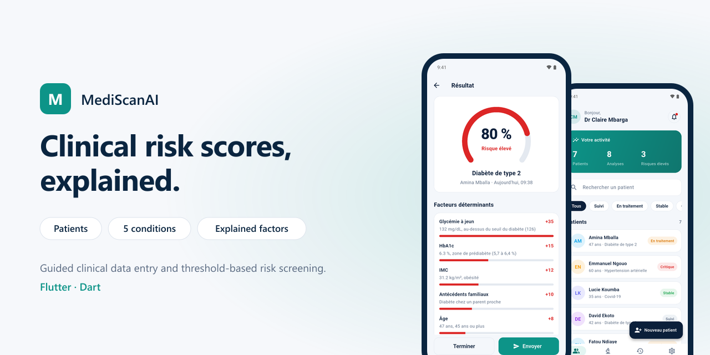
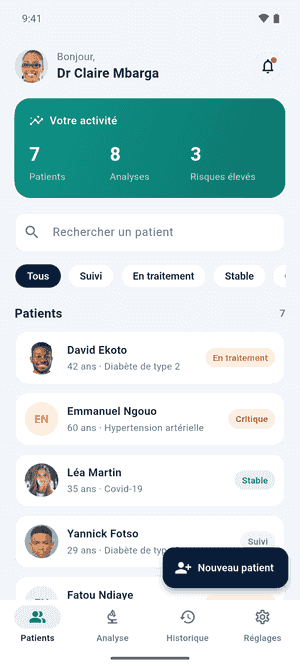
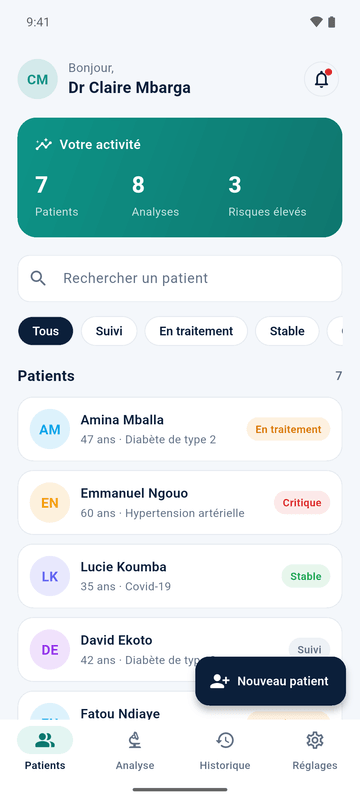
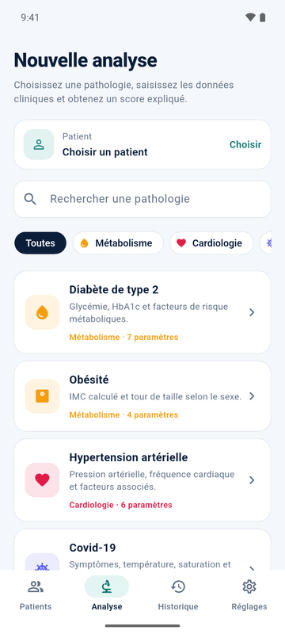
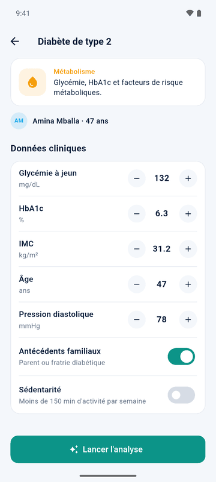
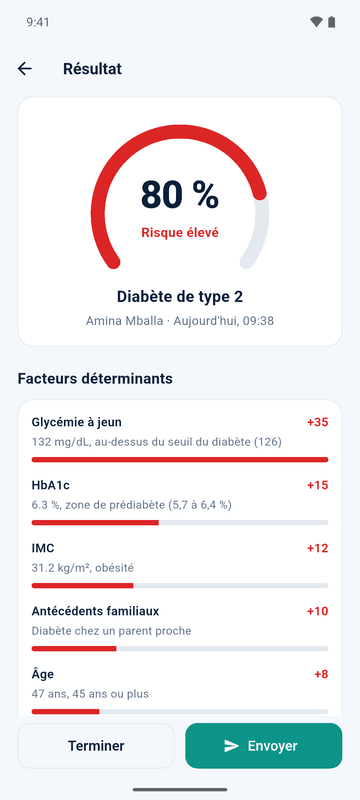
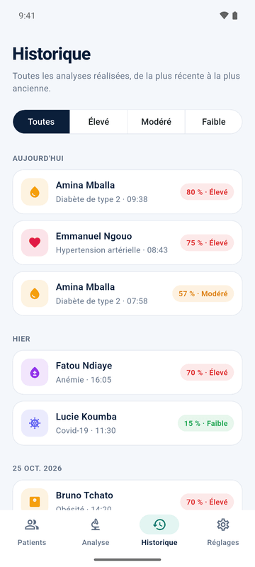
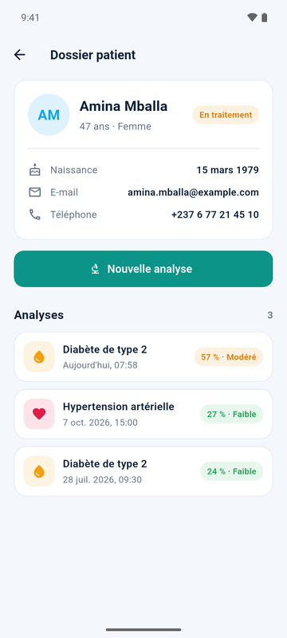

# MediScanAI

<p align="center"></p>


A Flutter app for doctors: follow patients, enter clinical data step by step and get a risk score that shows which factors raised it.

## Screens

<p align="center"></p>

| Patients | New analysis | Clinical data |
|:---:|:---:|:---:|
|  |  |  |

| Result | History | Patient record |
|:---:|:---:|:---:|
|  |  |  |

## Features

- **Patients**: list with search and status filters, activity overview, patient record with every past analysis, new patient form.
- **New analysis**: five conditions in four categories, searchable. Age and sex are prefilled from the patient record.
- **Clinical data**: one row per value, with its unit, a stepper and direct input; yes/no and choice values.
- **Result**: score from 0 to 100 %, risk level, the factors behind it with their weight, the values entered and what to do next.
- **History**: all analyses grouped by day, filtered by risk level.
- **Sending results**: the result can be emailed to the patient (see [Email](#email)).
- **Phone sign-in** with country selection, using [flutter_flag_selector](https://pub.dev/packages/flutter_flag_selector), my own package.

## How the score works

Each analysis compares the values entered with the thresholds of clinical guidelines. Every threshold crossed adds points, and the score is their total, capped at 100 %.

| Condition | Values used | Reference thresholds |
|---|---|---|
| Type 2 diabetes | Fasting glucose, HbA1c, BMI, age, diastolic pressure, family history, physical activity | ADA: glucose 100 and 126 mg/dL, HbA1c 5.7 and 6.5 % |
| Obesity | Weight, height (BMI computed), waist, sex | WHO: BMI 25, 30, 35, 40; waist by sex |
| Hypertension | Systolic and diastolic pressure, heart rate, cholesterol, age, smoking | ESC/ESH: 130/85, 140/90, 180/110 mmHg |
| Covid-19 | Temperature, SpO₂, cough, shortness of breath, loss of smell, exposure | Fever 38 °C, SpO₂ under 94 % |
| Anaemia | Haemoglobin, sex, heart rate, fatigue, pallor | WHO: 8, 11, 12 (women) and 13 (men) g/dL |

Under 30 % the risk is low, from 30 to 59 % moderate, from 60 % high. The rules live in [`lib/data/diseases.dart`](lib/data/diseases.dart) and are covered by tests.

The score is a screening aid, not a diagnosis.

## Tech stack

- Flutter, Dart, Material 3
- State in a `ChangeNotifier` shared through an `InheritedNotifier`, no extra package
- [flutter_flag_selector](https://pub.dev/packages/flutter_flag_selector), [mailer](https://pub.dev/packages/mailer)

```
lib/
├── data/       conditions and their scoring rules, sample patients
├── models/     patient, condition, clinical value, risk result, analysis
├── services/   app state, email, date formatting
├── screens/    sign-in, patients, patient record, new analysis,
│               clinical data, result, history, settings
└── widgets/    cards, badges, risk gauge, new patient form
```

## Getting started

```bash
flutter pub get
flutter run
```

The sign-in form is prefilled with a demo account. Patients and analyses are sample data kept in memory.

### Email

SMTP credentials are passed at build time, never stored in the code:

```bash
flutter run --dart-define=SMTP_USER=you@example.com --dart-define=SMTP_PASSWORD=app-password
```

`SMTP_HOST` (default `smtp.gmail.com`) and `SMTP_PORT` (default `587`) can be set the same way. Without credentials, the app says that email is not configured.

### Tests

```bash
flutter test
```

## Roadmap

- [ ] Store patients and analyses (local database, then a backend)
- [ ] Score trends over time in the patient record
- [ ] Machine learning models served by an API, alongside the threshold-based score
- [ ] PDF export of a result

## License

MIT, see [LICENSE](LICENSE).

## Author

**Dissang Kevin** · Mobile AI Engineer
[Portfolio](https://dissangkevin.work) · [GitHub](https://github.com/kteken10)
